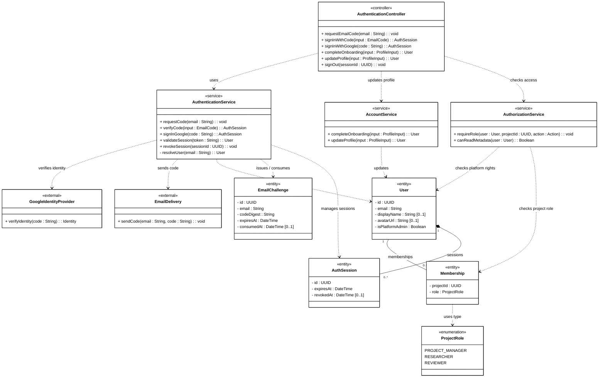
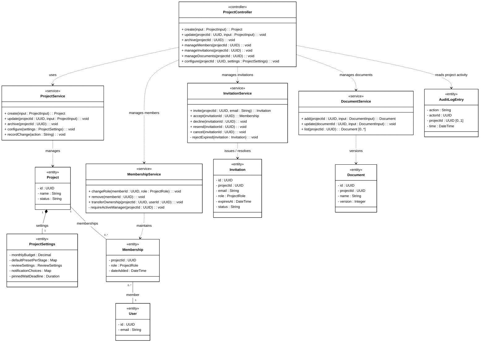
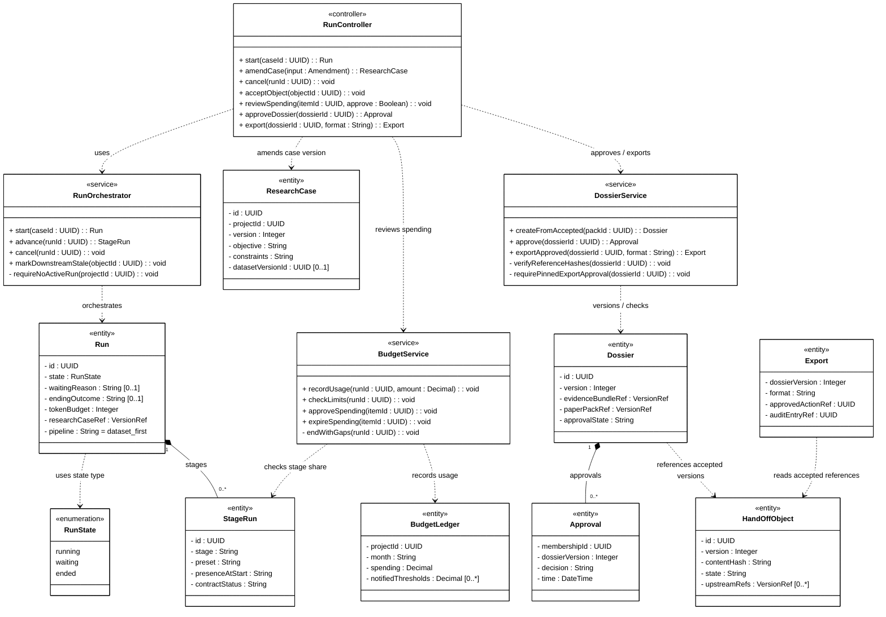
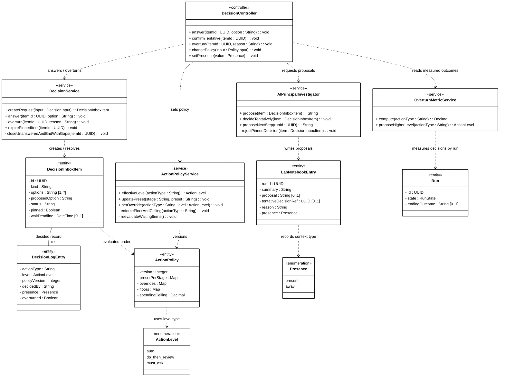
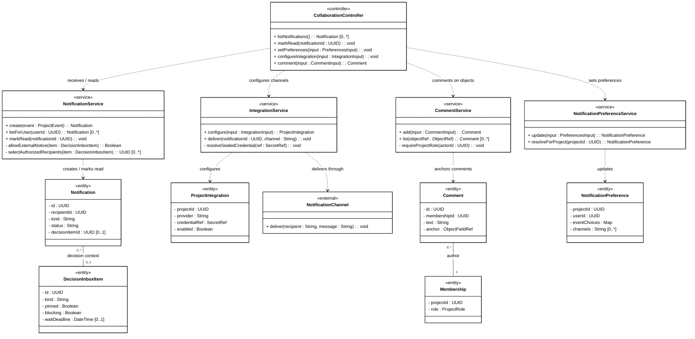
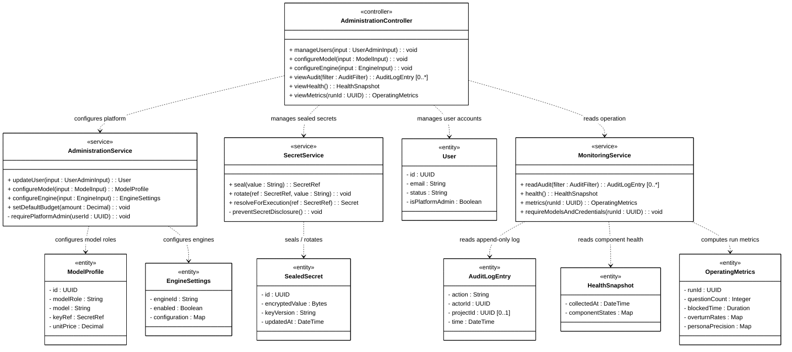

# Class Diagram — Mermaid (8 nhóm feature)

Mỗi khối là một sơ đồ độc lập. Dán khối `mermaid` vào trình hỗ trợ Mermaid hoặc diagrams.net để tiếp tục chỉnh bố cục. `direction TB` đặt hướng từ trên xuống; Mermaid tự quyết định vị trí thực tế nên có thể cần di chuyển thủ công sau khi import.

Nguồn nội dung: [diagram editable hiện tại](Class-Diagram-Authentication-Account.drawio), [thuyết minh](Class-Diagrams-design.md), [Report IV](../../report/04-software-design-document.md) và [Report III](../../report/03-software-requirements-specification.md). Controller/service, một số class, thành viên và chữ ký là thiết kế đề xuất, không mặc định là code/API thực tế. Local Node là thiết kế dự kiến, chưa triển khai.

Ký hiệu: `..>` dependency (mũi tên mở tới bên được dùng); `--` association; `*--` composition (thoi đặc ở bên toàn thể); `..|>` realization (tam giác rỗng tại interface). Số trong dấu nháy nằm ở đúng đầu quan hệ. Chỉ dùng composition khi có căn cứ về sở hữu và vòng đời; không đổi các association khác chỉ để đủ loại.

Các composition sau là **lựa chọn mô hình hóa đề xuất** cho sơ đồ vẽ tay; thoi đặc luôn đặt ở phía toàn thể:

| Toàn thể | Thành phần | Cách hiểu trong sơ đồ và căn cứ |
|---|---|---|
| `User` | `AuthSession` | Session thuộc một user; model backend gắn session với user. |
| `Project` | `ProjectSettings` | Cấu hình riêng của project; đối chiếu thiết kế và model backend. |
| `Dataset` | `DatasetVersion` | Mỗi version là thành phần thuộc một dataset; version cũ vẫn được giữ bất biến. |
| `Run` | `StageRun` | Mỗi stage run là một phần của lần chạy tương ứng. |
| `Dossier` | `Approval` | Approval thuộc đúng một phiên bản Dossier và không chuyển sang phiên bản mới. |
| `Lock` | `Envelope` | Envelope gắn với một Lock; mô hình này coi envelope là thành phần của lock. |

Các dấu thoi trên thể hiện giả định sở hữu/vòng đời ở mức thiết kế, **không tự khẳng định database phải xóa dây chuyền** hoặc xóa lịch sử. Report mô tả quan hệ và việc lưu giữ, nhưng chưa xác định đầy đủ vòng đời khi xóa cho mọi cặp; cần người phụ trách thiết kế xác nhận, đặc biệt với DatasetVersion, StageRun, Approval và Envelope. Hiện `DatasetVersion` và `StageRun` trong backend có `RESTRICT`, nên không diễn giải composition là xóa cascade. Sáu quan hệ composition đã được đồng bộ sang [file draw.io](Class-Diagram-Authentication-Account.drawio).

`DecisionInboxItem`–`DecisionLogEntry` giữ association vì log còn liên quan lịch sử/audit và chưa rõ có được sở hữu độc quyền bởi item hay không. `GoogleSheetsConnector ..|> Connector` mô tả sự phù hợp cấu trúc với Python Protocol; signature connector đã rút gọn ở mức UML. Xem [thuyết minh](Class-Diagrams-design.md) để phân biệt đề xuất thiết kế và implementation.

## 1. Authentication & Account

11 classifier; 14 quan hệ.

## 2. Project Workspace

12 classifier; 12 quan hệ.

## 3. Data Management

15 classifier; 15 quan hệ.

```mermaid
%%{init: {"theme": "base", "themeVariables": {"primaryColor": "#ffffff", "primaryBorderColor": "#000000", "primaryTextColor": "#000000", "secondaryColor": "#ffffff", "tertiaryColor": "#ffffff", "lineColor": "#000000", "textColor": "#000000", "background": "#ffffff"}}}%%
classDiagram
    direction TB
    class DataController {
        <<controller>>
        + upload(input : UploadInput) : DatasetVersion
        + importData(connectionId : UUID) : DatasetVersion
        + preview(versionId : UUID) : TablePreview
        + pairNode(code : String) : LocalNode
        + runLocal(job : LocalJob) : Release
    }
    class DataService {
        <<service>>
        + createDataset(input : DatasetInput) : Dataset
        + importData(connection : DataConnection) : DatasetVersion
        - requireAuthorizedSource(uri : String) : void
        - blockInternalHosts(uri : String) : void
        - rejectLocalPreview(dataset : Dataset) : void
    }
    class Dataset {
        <<entity>>
        - id : UUID
        - projectId : UUID
        - name : String
        - location : DataLocation
    }
    class DataConnection {
        <<entity>>
        - id : UUID
        - provider : String
        - authorizationScope : String
        - credentialRef : SecretRef
    }
    class DatasetVersionService {
        <<service>>
        + create(datasetId : UUID, source : String) : DatasetVersion
        + verifyHash(version : DatasetVersion) : Boolean
        - preventOverwrite(versionId : UUID) : void
    }
    class DatasetVersion {
        <<entity>>
        - id : UUID
        - contentHash : String
        - source : String
        - createdAt : DateTime
    }
    class DataLocation {
        <<enumeration>>
        platform
        local
    }
    class LocalNodeService {
        <<service>>
        + pair(projectId : UUID, code : String) : LocalNode
        + route(job : LocalJob) : void
        + revoke(nodeId : UUID) : void
        - rejectUnavailableNode(nodeId : UUID) : void
    }
    class LocalNode {
        <<entity>>
        - id : UUID
        - projectId : UUID
        - status : String
        - isolationManifest : String
    }
    class ReleaseLog {
        <<entity>>
        - datasetVersionId : UUID
        - appendOnly : Boolean
    }
    class ReleaseGate {
        <<service>>
        + check(job : LocalJob, result : Aggregate) : Release
        - applyFirewall(result : Aggregate) : void
        - round(result : Aggregate) : Aggregate
        - checkDisclosure(result : Aggregate) : void
        - checkDifferencing(result : Aggregate) : void
        - checkProbeBudget(versionId : UUID) : void
    }
    class Release {
        <<entity>>
        - id : UUID
        - jobId : UUID
        - kind : String
        - reason : String
        - time : DateTime
    }
    class ConnectorFactory {
        <<interface>>
        + __call__(kind : String, config : Map, secret : Map) : Connector
    }
    class Connector {
        <<interface>>
        + test() : void
        + listTables(schema : String, search : String [0..1], limit : Integer) : TableRef [0..*]
        + listColumns(schema : String, table : String) : Column [0..*]
        + openRows(source : AnySource, maxRows : Integer [0..1]) : AsyncContext~RowStream~
    }
    class GoogleSheetsConnector {
        <<service>>
        + test() : void
        + listTables(schema : String, search : String [0..1], limit : Integer) : TableRef [0..*]
        + listColumns(schema : String, table : String) : Column [0..*]
        + openRows(source : AnySource, maxRows : Integer [0..1]) : AsyncContext~RowStream~
    }
    DataController ..> DataService : uses
    DataController ..> DatasetVersionService : versions data
    DataController ..> LocalNodeService : routes local work
    DataController ..> ReleaseGate : checks aggregates
    DataService ..> Dataset : manages
    Dataset "0..*" -- "0..1" DataConnection : imports from
    Dataset "1" *-- "0..*" DatasetVersion : versions
    DatasetVersionService ..> DatasetVersion : creates / verifies
    Dataset ..> DataLocation : uses location type
    LocalNodeService ..> LocalNode : pairs / revokes
    LocalNode ..> ReleaseLog : appends locally
    ReleaseGate ..> Release : approves release
    DataService ..> ConnectorFactory : uses factory
    ConnectorFactory ..> Connector : creates connector
    GoogleSheetsConnector ..|> Connector : implements
```

## 4. Research Run Orchestration

13 classifier; 13 quan hệ.

## 5. Research Engines

15 classifier; 13 quan hệ.

```mermaid
%%{init: {"theme": "base", "themeVariables": {"primaryColor": "#ffffff", "primaryBorderColor": "#000000", "primaryTextColor": "#000000", "secondaryColor": "#ffffff", "tertiaryColor": "#ffffff", "lineColor": "#000000", "textColor": "#000000", "background": "#ffffff"}}}%%
classDiagram
    direction TB
    class DatasetEngine {
        <<service>>
        + profile(versionId : UUID) : DatasetSnapshot
        + assessFitness(snapshot : DatasetSnapshot) : Fitness
        + splitAfterConfirmation(input : SplitInput) : void
    }
    class DatasetSnapshot {
        <<entity>>
        - versionRef : VersionRef
        - qualityProfile : QualityProfile
        - dictionary : Dictionary
        - split : SplitSpec
        - fitness : Fitness
    }
    class HypothesisEngine {
        <<service>>
        + updateLiterature(projectId : UUID) : LiteratureBase
        + propose(snapshot : DatasetSnapshot) : HypothesisSet
        + selectPrimary(input : Selection) : void
    }
    class HypothesisSet {
        <<entity>>
        - snapshotRef : VersionRef
        - literatureVersionRef : VersionRef
        - hypotheses : Hypothesis [2..*]
        - primaryClaimKey : String
    }
    class ExperimentDesignEngine {
        <<service>>
        + build(set : HypothesisSet) : AnalysisPlan
        + rehearseOnTwin(plan : AnalysisPlan) : CheckResult
        + requestUserLock(planId : UUID) : void
    }
    class AnalysisPlan {
        <<entity>>
        - hypothesisSetRef : VersionRef
        - patternRefs : VersionRef [0..*]
        - taskFamily : String
        - pipelineOrder : String [1..*]
        - interpretationTable : Table
    }
    class ExecutionEngine {
        <<service>>
        + execute(lock : Lock) : EvidenceBundle
        + dryRun(lock : Lock) : Diagnostics
        + requestUnseal(lockId : UUID) : void
        + computeVerdicts(input : EvidenceInput) : Verdict [1..*]
    }
    class EvidenceBundle {
        <<entity>>
        - analysisPlanRef : VersionRef
        - verdicts : Verdict [1..*]
        - grade : String
        - claimCeiling : String
        - replicationHash : String
    }
    class PaperEngine {
        <<service>>
        + draft(input : PaperInput) : PaperPack
        + renderNumbers(bundle : EvidenceBundle) : void
        + validateClaimsAndCitations(pack : PaperPack) : CheckResult
    }
    class PaperPack {
        <<entity>>
        - evidenceBundleRef : VersionRef
        - manuscript : String
        - reportingChecklist : Checklist
        - limitations : String [0..*]
        - authorDeclarations : Declaration [0..*]
    }
    class IndependentReviewService {
        <<service>>
        + review(object : HandOffObject) : Finding [0..*]
        + verify(finding : Finding) : String
        + reviseConfirmedBlockers(objectId : UUID) : void
        - enforceTwoRounds(round : Integer) : void
    }
    class Finding {
        <<entity>>
        - anchor : ObjectFieldRef
        - evidence : EvidenceRef
        - severity : String
        - verificationResult : String
        - proposedFix : String
    }
    class Harness {
        <<service>>
        + checkContract(object : HandOffObject) : CheckResult
        + enforcePipelineOrder(plan : AnalysisPlan) : void
        + checkItemBudget(itemId : UUID) : void
        + renderNumbers(records : Record [0..*]) : String
    }
    class Lock {
        <<entity>>
        - analysisPlanRef : VersionRef
        - specHash : String
        - programHash : String
        - splitDigest : String
        - lockedBy : UUID
        - lockedAt : DateTime
    }
    class Envelope {
        <<entity>>
        - lockId : UUID
        - state : String
        - sealedResults : Result [0..*]
        - unsealedAt : DateTime [0..1]
    }
    DatasetEngine ..> DatasetSnapshot : publishes
    HypothesisEngine ..> HypothesisSet : publishes
    ExperimentDesignEngine ..> AnalysisPlan : publishes
    ExecutionEngine ..> EvidenceBundle : publishes
    PaperEngine ..> PaperPack : publishes
    IndependentReviewService ..> Finding : verifies
    HypothesisEngine ..> DatasetSnapshot : reads pinned snapshot
    ExecutionEngine ..> AnalysisPlan : reads locked plan
    IndependentReviewService ..> PaperPack : reviews object version
    PaperEngine ..> Harness : runs checks
    ExecutionEngine ..> IndependentReviewService : reviews evidence
    Harness ..> Lock : checks locked plan
    Lock "1" *-- "1" Envelope : sealed results
```

## 6. AI Principal Investigator

12 classifier; 12 quan hệ.

## 7. Notifications & Integrations

12 classifier; 11 quan hệ.

## 8. Administration & Monitoring

11 classifier; 10 quan hệ.

