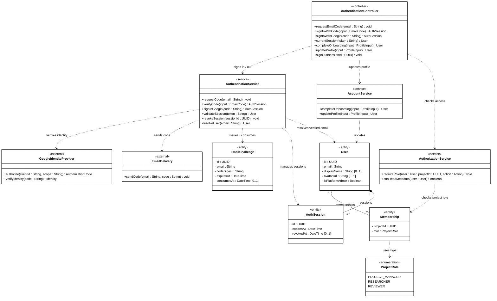
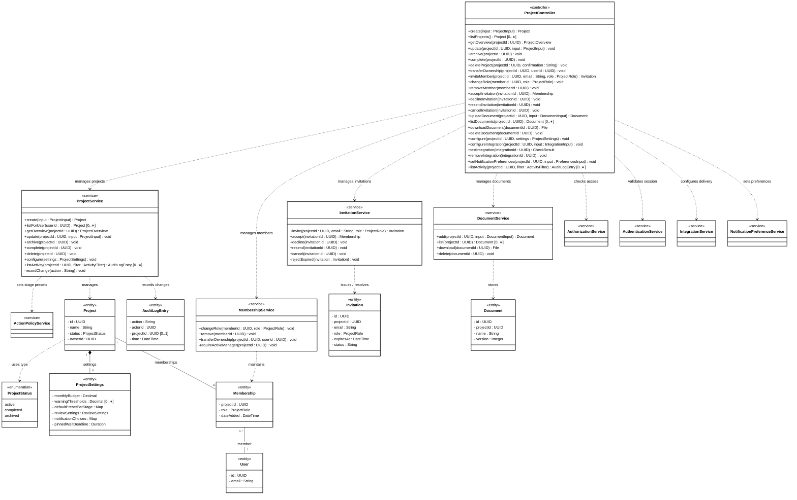
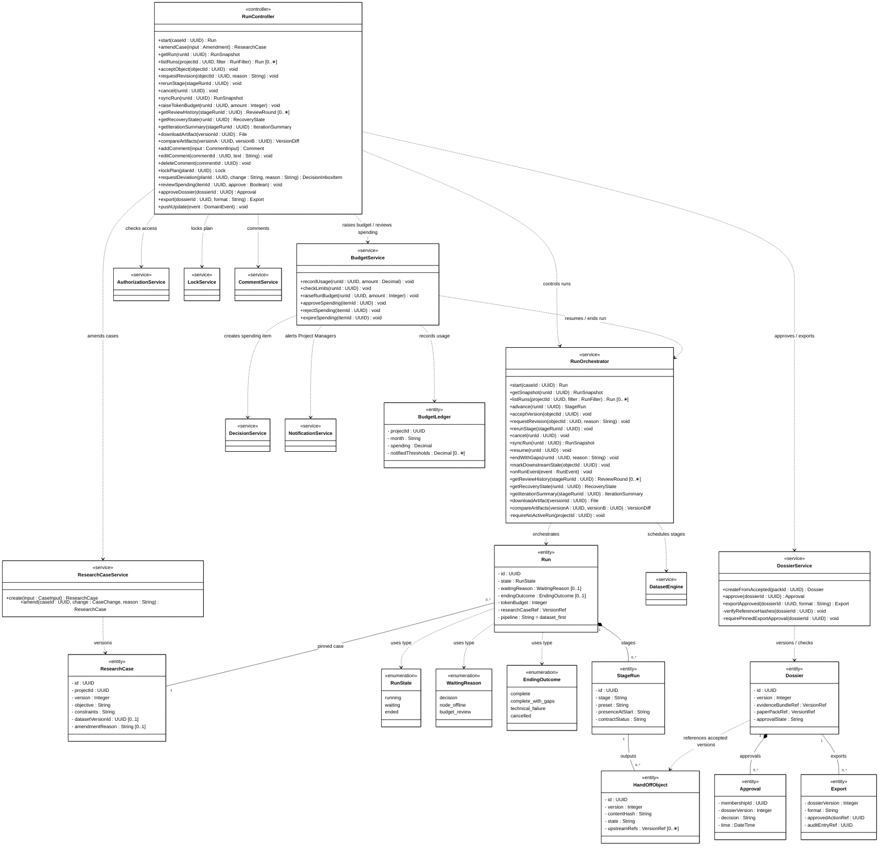
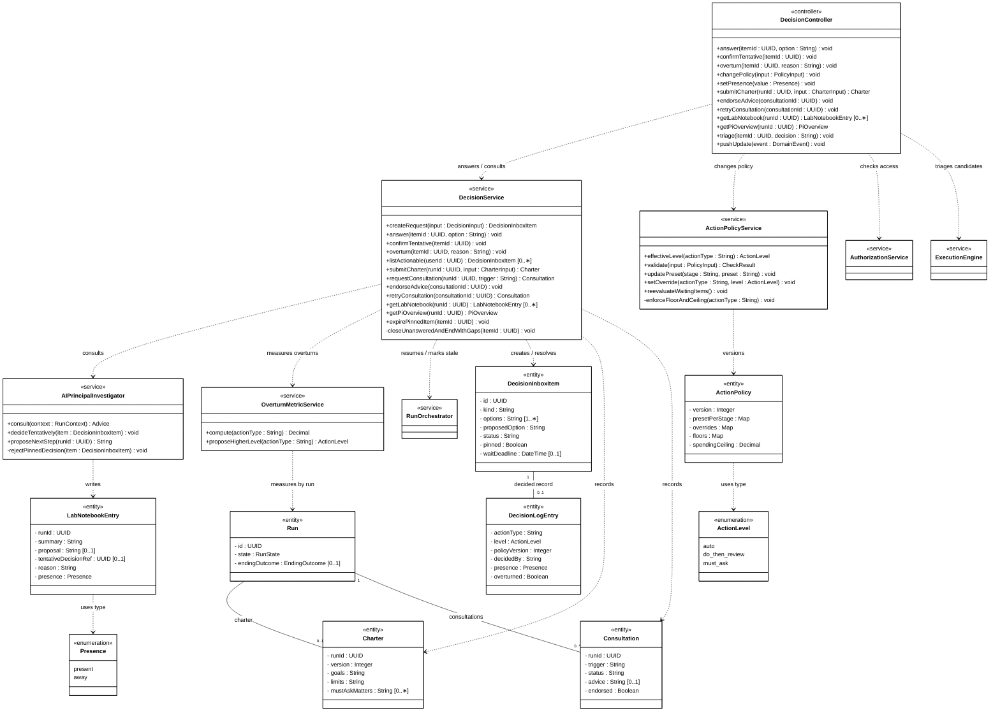

# Class Diagrams — Mermaid

Xuất từ [class_model.py](class_model.py) bằng [build_class_diagrams.py](build_class_diagrams.py), cùng nội dung với file draw.io; mỗi khối đặt nền trắng, chữ và nét đen. Class chỉ có tên (không ngăn thành viên) thuộc nhóm khác và được vẽ lại để thể hiện phụ thuộc. Chạy lại builder sẽ ghi đè các chỉnh tay trong file này.

## 1. Authentication & Account

## 2. Project Workspace

## 3. Data Management

```mermaid
%%{init: {'theme': 'base', 'themeVariables': {'background': '#ffffff', 'mainBkg': '#ffffff', 'primaryColor': '#ffffff', 'primaryBorderColor': '#000000', 'primaryTextColor': '#000000', 'lineColor': '#000000', 'textColor': '#000000', 'fontFamily': 'Arial'}}}%%
classDiagram
    class DataController {
        <<controller>>
        +upload(input : UploadInput) DatasetVersion
        +getDataset(datasetId : UUID) DatasetDetail
        +renameDataset(datasetId : UUID, name : String) void
        +deleteDataset(datasetId : UUID) void
        +uploadVersion(datasetId : UUID, input : UploadInput) DatasetVersion
        +preview(versionId : UUID) TablePreview
        +download(versionId : UUID) File
        +importData(connectionId : UUID) DatasetVersion
        +browseConnection(connectionId : UUID, schema : String) TableRef [0..∗]
        +previewSource(connectionId : UUID, source : AnySource) TablePreview
        +renameConnection(connectionId : UUID, name : String) void
        +testConnection(connectionId : UUID) CheckResult
        +deleteConnection(connectionId : UUID) void
        +connectGoogle(projectId : UUID) DataConnection
        +requestPairingCode(projectId : UUID) PairingCode
        +pairNode(code : String) LocalNode
        +proposeDatasets(nodeId : UUID, manifests : Manifest [1..∗]) void
        +revokeNode(nodeId : UUID) void
        +pushUpdate(event : DomainEvent) void
    }
    class DataService {
        <<service>>
        +createDataset(input : DatasetInput) Dataset
        +getDetail(datasetId : UUID) DatasetDetail
        +rename(datasetId : UUID, name : String) void
        +delete(datasetId : UUID) void
        +addVersion(datasetId : UUID, input : UploadInput) DatasetVersion
        +preview(versionId : UUID) TablePreview
        +download(versionId : UUID) File
        +importData(connection : DataConnection) DatasetVersion
        +browse(connectionId : UUID, schema : String) TableRef [0..∗]
        +previewSource(connectionId : UUID, source : AnySource) TablePreview
        +renameConnection(connectionId : UUID, name : String) void
        +testConnection(connectionId : UUID) CheckResult
        +deleteConnection(connectionId : UUID) void
        +authorizeGoogle(projectId : UUID) DataConnection
        -blockInternalHosts(uri : String) void
        -rejectLocalPreview(dataset : Dataset) void
    }
    class DatasetVersionService {
        <<service>>
        +create(datasetId : UUID, source : String) DatasetVersion
        +verifyHash(version : DatasetVersion) Boolean
        -preventOverwrite(versionId : UUID) void
    }
    class LocalNodeService {
        <<service>>
        +issuePairingCode(projectId : UUID) PairingCode
        +pair(projectId : UUID, code : String) LocalNode
        +registerDatasets(nodeId : UUID, manifests : Manifest [1..∗]) Dataset [1..∗]
        +route(job : LocalJob) JobResult
        +heartbeat(nodeId : UUID) void
        +revoke(nodeId : UUID) void
        -rejectUnavailableNode(nodeId : UUID) void
    }
    class AuthorizationService {
        <<service>>
    }
    class SecretService {
        <<service>>
    }
    class NotificationService {
        <<service>>
    }
    class RunOrchestrator {
        <<service>>
    }
    class ExecutionEngine {
        <<service>>
    }
    class GoogleIdentityProvider {
        <<external>>
    }
    class ConnectorFactory {
        <<interface>>
        +#95;#95;call#95;#95;(kind : String, config : Map, secret : Map) Connector
    }
    class Connector {
        <<interface>>
        +test() void
        +listTables(schema : String, search : String [0..1], limit : Integer) TableRef [0..∗]
        +listColumns(schema : String, table : String) Column [0..∗]
        +openRows(source : AnySource, maxRows : Integer [0..1]) AsyncContext~RowStream~
    }
    class GoogleSheetsConnector {
        <<service>>
        +test() void
        +listTables(schema : String, search : String [0..1], limit : Integer) TableRef [0..∗]
        +listColumns(schema : String, table : String) Column [0..∗]
        +openRows(source : AnySource, maxRows : Integer [0..1]) AsyncContext~RowStream~
    }
    class LocalNodeAgent {
        <<external>>
        +runJob(job : LocalJob) JobResult
    }
    class ReleaseGate {
        <<service>>
        +check(job : LocalJob, result : Aggregate) Release
        +recordRelease(release : Release) void
        -applyFirewall(result : Aggregate) void
        -round(result : Aggregate) Aggregate
        -checkDisclosure(result : Aggregate) void
        -checkDifferencing(result : Aggregate) void
        -checkProbeBudget(versionId : UUID) void
    }
    class Dataset {
        <<entity>>
        - id : UUID
        - projectId : UUID
        - name : String
        - location : DataLocation
    }
    class DatasetVersion {
        <<entity>>
        - id : UUID
        - contentHash : String
        - source : String
        - createdAt : DateTime
    }
    class DataLocation {
        <<enumeration>>
        platform
        local
    }
    class DataConnection {
        <<entity>>
        - id : UUID
        - provider : String
        - authorizationScope : String
        - credentialRef : SecretRef
    }
    class LocalNode {
        <<entity>>
        - id : UUID
        - projectId : UUID
        - status : LocalNodeStatus
        - lastSeenAt : DateTime [0..1]
        - revokedAt : DateTime [0..1]
    }
    class LocalNodeStatus {
        <<enumeration>>
        pairing
        online
        offline
        revoked
    }
    class ReleaseLog {
        <<entity>>
        - datasetVersionId : UUID
        - appendOnly : Boolean
    }
    class Release {
        <<entity>>
        - id : UUID
        - jobId : UUID
        - kind : String
        - reason : String
        - time : DateTime
    }
    DataController ..> DataService : manages datasets
    DataController ..> LocalNodeService : manages Local Nodes
    DataController ..> AuthorizationService : checks access
    DataService ..> DatasetVersionService : creates versions
    DataService ..> SecretService : seals credentials
    DataService ..> ConnectorFactory : uses factory
    DataService ..> GoogleIdentityProvider : authorizes Google source
    DataService ..> Dataset : manages
    ConnectorFactory ..> Connector : creates connector
    GoogleSheetsConnector ..|> Connector : implements
    DatasetVersionService ..> DatasetVersion : creates / verifies
    ExecutionEngine ..> LocalNodeService : routes local job
    LocalNodeService ..> LocalNodeAgent : dispatches jobs
    LocalNodeService ..> NotificationService : sends offline notice
    LocalNodeService ..> RunOrchestrator : resumes waiting run
    LocalNodeService ..> LocalNode : pairs / revokes
    LocalNodeAgent ..> ReleaseGate : checks aggregates
    ReleaseGate ..> ReleaseLog : appends
    Dataset "1" *-- "0..*" DatasetVersion : versions
    Dataset ..> DataLocation : uses type
    Dataset "0..*" -- "0..1" DataConnection : imports from
    LocalNode ..> LocalNodeStatus : uses type
    ReleaseLog "1" *-- "0..*" Release : releases
```

## 4. Research Run Orchestration

## 5. Research Engines

```mermaid
%%{init: {'theme': 'base', 'themeVariables': {'background': '#ffffff', 'mainBkg': '#ffffff', 'primaryColor': '#ffffff', 'primaryBorderColor': '#000000', 'primaryTextColor': '#000000', 'lineColor': '#000000', 'textColor': '#000000', 'fontFamily': 'Arial'}}}%%
classDiagram
    class LiteratureController {
        <<controller>>
        +search(projectId : UUID, query : String) StudyRef [0..∗]
        +screen(decisions : ScreeningDecision [1..∗]) LiteratureBase
    }
    class RunOrchestrator {
        <<service>>
    }
    class DecisionService {
        <<service>>
    }
    class RunController {
        <<service>>
    }
    class AuthorizationService {
        <<service>>
    }
    class DatasetEngine {
        <<service>>
        +profile(versionId : UUID) DatasetSnapshot
    }
    class HypothesisEngine {
        <<service>>
        +propose(snapshot : DatasetSnapshot) HypothesisSet
    }
    class ExperimentDesignEngine {
        <<service>>
        +build(set : HypothesisSet) AnalysisPlan
    }
    class ExecutionEngine {
        <<service>>
        +execute(lock : Lock) EvidenceBundle
        +runExplorationLane(planId : UUID) void
        +triage(itemId : UUID, decision : String) Candidate
    }
    class PaperEngine {
        <<service>>
        +draft(input : PaperInput) PaperPack
    }
    class LiteratureService {
        <<service>>
        +search(query : String) StudyRef [0..∗]
        +screen(decisions : ScreeningDecision [1..∗]) LiteratureBase
    }
    class LockService {
        <<service>>
        +lock(planId : UUID) Lock
        +requestDeviation(planId : UUID, change : String, reason : String) DecisionInboxItem
    }
    class IndependentReviewService {
        <<service>>
        +review(object : HandOffObject) Finding [0..∗]
        -enforceTwoRounds(round : Integer) void
    }
    class ReviewerPersona {
        <<service>>
        +review(object : HandOffObject, fields : String [1..∗]) Finding [0..∗]
    }
    class MakerPersona {
        <<service>>
        +revise(objectId : UUID, findings : Finding [1..∗]) HandOffObject
    }
    class Harness {
        <<service>>
        +checkContract(object : HandOffObject) CheckResult
        +enforcePipelineOrder(plan : AnalysisPlan) void
        +renderNumbers(records : Record [0..∗]) String
        +computeProfile(versionId : UUID) Profile
        +createSplit(snapshotId : UUID, policy : SplitPolicy) SplitSpec
        +validatePortfolio(set : HypothesisSet) CheckResult
        +rehearseOnTwin(plan : AnalysisPlan) CheckResult
        +checkDisclosureEligibility(lockId : UUID) CheckResult
        +computeVerdicts(input : EvidenceInput) Verdict [1..∗]
        +validateClaimsAndCitations(pack : PaperPack) CheckResult
        +verifyFindings(findings : Finding [1..∗]) Finding [0..∗]
        +recheckChangedFields(objectId : UUID) CheckResult
        +scoreCase(caseId : UUID, findings : Finding [0..∗]) CaseResult
        +computeBenchmarkMetrics(benchmarkRunId : UUID) BenchmarkMetrics
    }
    class ScholarlySource {
        <<external>>
        +search(query : String) SourceRecord [0..∗]
    }
    class IsolatedExecutor {
        <<external>>
        +runTwin(lock : Lock) Diagnostics
        +dryRun(lock : Lock) Diagnostics
        +runConfirmatory(lock : Lock) JobStatus
    }
    class DatasetSnapshot {
        <<entity>>
        - versionRef : VersionRef
        - qualityProfile : QualityProfile
        - dictionary : Dictionary
        - split : SplitSpec
        - fitness : Fitness
    }
    class HypothesisSet {
        <<entity>>
        - snapshotRef : VersionRef
        - literatureVersionRef : VersionRef
        - hypotheses : Hypothesis [2..∗]
        - primaryClaimKey : String
    }
    class LiteratureBase {
        <<entity>>
        - projectId : UUID
        - version : Integer
        - searchProtocol : String
        - searchLog : SearchEntry [0..∗]
        - screeningDecisions : ScreeningDecision [0..∗]
        - evidenceCards : EvidenceCard [0..∗]
    }
    class AnalysisPlan {
        <<entity>>
        - hypothesisSetRef : VersionRef
        - patternRefs : VersionRef [0..∗]
        - taskFamily : String
        - pipelineOrder : String [1..∗]
        - interpretationTable : Table
    }
    class Lock {
        <<entity>>
        - analysisPlanRef : VersionRef
        - specHash : String
        - programHash : String
        - splitDigest : String
        - lockedBy : UUID
        - lockedAt : DateTime
    }
    class ConfirmatoryResults {
        <<entity>>
        - lockId : UUID
        - state : String
        - results : Result [0..∗]
        - disclosedAt : DateTime [0..1]
    }
    class EvidenceBundle {
        <<entity>>
        - analysisPlanRef : VersionRef
        - verdicts : Verdict [1..∗]
        - grade : String
        - claimCeiling : String
        - triedLedger : TriedEntry [0..∗]
        - candidates : Candidate [0..∗]
        - replicationHash : String
    }
    class PaperPack {
        <<entity>>
        - evidenceBundleRef : VersionRef
        - manuscript : String
        - reportingChecklist : Checklist
        - limitations : String [0..∗]
        - authorDeclarations : Declaration [0..∗]
    }
    class Finding {
        <<entity>>
        - anchor : ObjectFieldRef
        - evidence : EvidenceRef
        - severity : String
        - verificationResult : String
        - proposedFix : String
    }
    LiteratureController ..> LiteratureService : searches / screens
    LiteratureController ..> AuthorizationService : checks access
    RunOrchestrator ..> DatasetEngine : starts stage
    DatasetEngine ..> DecisionService : asks to confirm structure
    HypothesisEngine ..> ScholarlySource : searches literature
    LiteratureService ..> ScholarlySource : searches literature
    ExecutionEngine ..> IsolatedExecutor : runs jobs
    ExecutionEngine ..> RunController : pushes update
    LockService ..> DecisionService : requests deviation
    LockService ..> RunOrchestrator : schedules execution
    IndependentReviewService ..> ReviewerPersona : reviews with
    IndependentReviewService ..> MakerPersona : revises with
    IndependentReviewService ..> Harness : verifies findings
    PaperEngine ..> Harness : runs checks
    DatasetEngine ..> DatasetSnapshot : publishes
    HypothesisEngine ..> HypothesisSet : publishes
    LiteratureService ..> LiteratureBase : versions
    ExperimentDesignEngine ..> AnalysisPlan : publishes
    LockService ..> Lock : writes
    ExecutionEngine ..> EvidenceBundle : publishes
    PaperEngine ..> PaperPack : publishes
    IndependentReviewService ..> Finding : records
    HypothesisSet "0..*" -- "1" LiteratureBase : pins version
    Lock "1" *-- "1" ConfirmatoryResults : confirmatory results
```

## 6. AI Principal Investigator

## 7. Notifications & Integrations

```mermaid
%%{init: {'theme': 'base', 'themeVariables': {'background': '#ffffff', 'mainBkg': '#ffffff', 'primaryColor': '#ffffff', 'primaryBorderColor': '#000000', 'primaryTextColor': '#000000', 'lineColor': '#000000', 'textColor': '#000000', 'fontFamily': 'Arial'}}}%%
classDiagram
    class CollaborationController {
        <<controller>>
        +listNotifications() Notification [0..∗]
        +markRead(notificationId : UUID) void
        +markAllRead() void
        +setPreferences(input : PreferencesInput) void
        +listInbox() DecisionInboxItem [0..∗]
        +listReviewQueue() ReviewItem [0..∗]
        +pushUpdate(event : DomainEvent) void
    }
    class NotificationService {
        <<service>>
        +create(event : ProjectEvent) Notification
        +listForUser(userId : UUID) Notification [0..∗]
        +markRead(notificationId : UUID) void
        +markAllRead(userId : UUID) void
        +retryEmail(emailId : UUID) void
        -allowExternalNotice(item : DecisionInboxItem) Boolean
        -selectAuthorizedRecipients(item : DecisionInboxItem) UUID [0..∗]
    }
    class NotificationPreferenceService {
        <<service>>
        +update(input : PreferencesInput) NotificationPreference
        +resolveForProject(projectId : UUID) NotificationPreference
    }
    class IntegrationService {
        <<service>>
        +configure(input : IntegrationInput) ProjectIntegration
        +test(integrationId : UUID) CheckResult
        +remove(integrationId : UUID) void
        +deliver(notificationId : UUID, channel : String) void
        -resolveSealedCredential(ref : SecretRef) void
    }
    class CommentService {
        <<service>>
        +add(input : CommentInput) Comment
        +list(objectRef : ObjectRef) Comment [0..∗]
        +edit(commentId : UUID, text : String) void
        +delete(commentId : UUID) void
        -requireProjectRole(actorId : UUID) void
    }
    class ReviewService {
        <<service>>
        +listQueue(userId : UUID) ReviewItem [0..∗]
    }
    class AuthorizationService {
        <<service>>
    }
    class AuthenticationService {
        <<service>>
    }
    class DecisionService {
        <<service>>
    }
    class NotificationChannel {
        <<external>>
        +deliver(recipient : String, message : String) void
    }
    class Notification {
        <<entity>>
        - id : UUID
        - recipientId : UUID
        - kind : String
        - status : String
        - readAt : DateTime [0..1]
        - decisionItemId : UUID [0..1]
    }
    class NotificationEmail {
        <<entity>>
        - id : UUID
        - notificationId : UUID
        - status : EmailStatus
        - attempts : Integer
        - lastError : String [0..1]
    }
    class EmailStatus {
        <<enumeration>>
        pending
        sending
        sent
        failed
        skipped
    }
    class DecisionInboxItem {
        <<entity>>
        - id : UUID
        - kind : String
        - pinned : Boolean
        - blocking : Boolean
        - waitDeadline : DateTime [0..1]
    }
    class NotificationPreference {
        <<entity>>
        - projectId : UUID
        - userId : UUID
        - eventChoices : Map
        - channels : String [0..∗]
    }
    class ProjectIntegration {
        <<entity>>
        - projectId : UUID
        - provider : String
        - credentialRef : SecretRef
        - enabled : Boolean
    }
    class Comment {
        <<entity>>
        - id : UUID
        - membershipId : UUID
        - text : String
        - anchor : ObjectFieldRef
    }
    class Membership {
        <<entity>>
        - projectId : UUID
        - role : ProjectRole
    }
    CollaborationController ..> NotificationService : reads / marks read
    CollaborationController ..> NotificationPreferenceService : sets preferences
    CollaborationController ..> ReviewService : lists review queue
    CollaborationController ..> DecisionService : lists inbox
    CollaborationController ..> AuthorizationService : checks access
    CollaborationController ..> AuthenticationService : validates session
    NotificationService ..> NotificationPreferenceService : resolves settings
    NotificationService ..> IntegrationService : delivers external notice
    IntegrationService ..> NotificationChannel : delivers through
    NotificationService ..> Notification : creates / marks read
    NotificationService ..> NotificationEmail : queues / retries
    NotificationPreferenceService ..> NotificationPreference : updates
    IntegrationService ..> ProjectIntegration : configures
    CommentService ..> Comment : anchors
    ReviewService ..> Membership : reads memberships
    Notification "1" -- "0..1" NotificationEmail : email
    NotificationEmail ..> EmailStatus : uses type
    Notification "0..*" -- "0..1" DecisionInboxItem : decision context
    Comment "0..*" -- "1" Membership : author
```

## 8. Administration & Monitoring

```mermaid
%%{init: {'theme': 'base', 'themeVariables': {'background': '#ffffff', 'mainBkg': '#ffffff', 'primaryColor': '#ffffff', 'primaryBorderColor': '#000000', 'primaryTextColor': '#000000', 'lineColor': '#000000', 'textColor': '#000000', 'fontFamily': 'Arial'}}}%%
classDiagram
    class AdministrationController {
        <<controller>>
        +manageUsers(input : UserAdminInput) void
        +getUserDetail(userId : UUID) UserDetail
        +grantPlatformAdmin(userId : UUID) void
        +revokePlatformAdmin(userId : UUID) void
        +listAllProjects() ProjectMetadata [0..∗]
        +configureModel(input : ModelInput) void
        +configureEngine(input : EngineInput) void
        +viewOverview() PlatformOverview
        +viewUsage(filter : UsageFilter) UsageReport
        +viewAudit(filter : AuditFilter) AuditLogEntry [0..∗]
        +viewLogs(filter : LogFilter) LogEntry [0..∗]
        +viewHealth() HealthSnapshot
        +acknowledgeAlert(alertId : UUID) void
        +viewMetrics(runId : UUID) OperatingMetrics
        +runBenchmark(catalogueVersion : String, modelProfileId : UUID) BenchmarkRun
        +pushUpdate(event : DomainEvent) void
    }
    class AdministrationService {
        <<service>>
        +updateUser(input : UserAdminInput) User
        +getUserDetail(userId : UUID) UserDetail
        +grantPlatformAdmin(userId : UUID) void
        +revokePlatformAdmin(userId : UUID) void
        +listProjectMetadata() ProjectMetadata [0..∗]
        +configureModel(input : ModelInput) ModelProfile
        +configureEngine(input : EngineInput) EngineSettings
        +setDefaultBudget(amount : Decimal) void
        +requirePlatformAdmin(userId : UUID) void
    }
    class SecretService {
        <<service>>
        +seal(value : String) SecretRef
        +rotate(ref : SecretRef, value : String) void
        +resolveForExecution(ref : SecretRef) Secret
        -preventSecretDisclosure() void
    }
    class MonitoringService {
        <<service>>
        +overview() PlatformOverview
        +usage(filter : UsageFilter) UsageReport
        +readAudit(filter : AuditFilter) AuditLogEntry [0..∗]
        +logs(filter : LogFilter) LogEntry [0..∗]
        +health() HealthSnapshot
        +acknowledgeAlert(alertId : UUID) void
        +metrics(runId : UUID) OperatingMetrics
        +onMonitoringEvent(event : MonitoringEvent) void
        +requireModelsAndCredentials(runId : UUID) void
    }
    class BenchmarkService {
        <<service>>
        +runBenchmark(catalogueVersion : String, modelProfileId : UUID) BenchmarkRun
    }
    class ModelProvider {
        <<external>>
        +testModel(profileRef : SecretRef) CheckResult
    }
    class IndependentReviewService {
        <<service>>
    }
    class Harness {
        <<service>>
    }
    class User {
        <<entity>>
        - id : UUID
        - email : String
        - status : String
        - isPlatformAdmin : Boolean
    }
    class ModelProfile {
        <<entity>>
        - id : UUID
        - modelRole : String
        - model : String
        - keyRef : SecretRef
        - unitPrice : Decimal
    }
    class EngineSettings {
        <<entity>>
        - engineId : String
        - enabled : Boolean
        - configuration : Map
    }
    class SealedSecret {
        <<entity>>
        - id : UUID
        - encryptedValue : Bytes
        - keyVersion : String
        - updatedAt : DateTime
    }
    class AuditLogEntry {
        <<entity>>
        - action : String
        - actorId : UUID
        - projectId : UUID [0..1]
        - time : DateTime
    }
    class HealthSnapshot {
        <<entity>>
        - collectedAt : DateTime
        - componentStates : Map
    }
    class MonitoringAlert {
        <<entity>>
        - id : UUID
        - component : String
        - severity : String
        - state : AlertState
        - acknowledgedBy : UUID [0..1]
        - acknowledgedAt : DateTime [0..1]
        - resolvedAt : DateTime [0..1]
    }
    class AlertState {
        <<enumeration>>
        active
        resolved
    }
    class OperatingMetrics {
        <<entity>>
        - runId : UUID
        - questionCount : Integer
        - blockedTime : Duration
        - overturnRates : Map
        - personaPrecision : Map
    }
    class BenchmarkRun {
        <<entity>>
        - id : UUID
        - catalogueVersion : String
        - modelProfileId : UUID
        - personaPrecision : Map
        - leakageDetectionRate : Decimal
        - orderBlockRate : Decimal
        - finishedAt : DateTime [0..1]
    }
    AdministrationController ..> AdministrationService : configures platform
    AdministrationController ..> MonitoringService : reads operation
    AdministrationController ..> BenchmarkService : runs benchmark
    AdministrationService ..> SecretService : seals keys
    AdministrationService ..> ModelProvider : tests model
    AdministrationService ..> User : manages accounts
    AdministrationService ..> ModelProfile : configures model roles
    AdministrationService ..> EngineSettings : configures engines
    SecretService ..> SealedSecret : seals / rotates
    MonitoringService ..> AuditLogEntry : reads append-only log
    MonitoringService ..> HealthSnapshot : reads health
    MonitoringService ..> MonitoringAlert : raises / acknowledges
    MonitoringService ..> OperatingMetrics : computes
    BenchmarkService ..> IndependentReviewService : runs personas
    BenchmarkService ..> Harness : scores cases
    BenchmarkService ..> BenchmarkRun : records
    MonitoringAlert ..> AlertState : uses type
    BenchmarkRun "0..*" -- "1" ModelProfile : model under test
```

