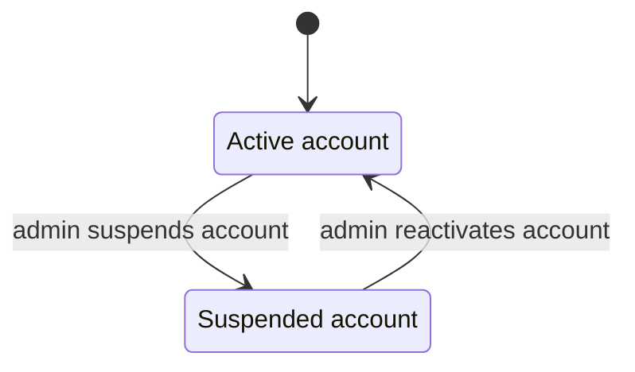
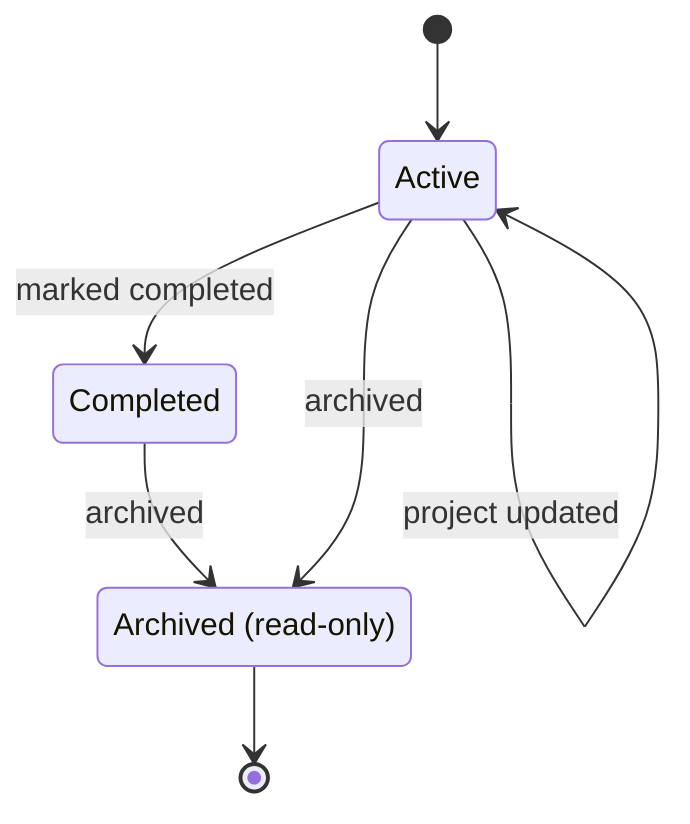
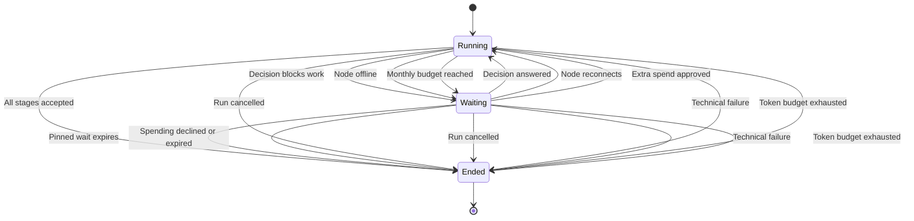
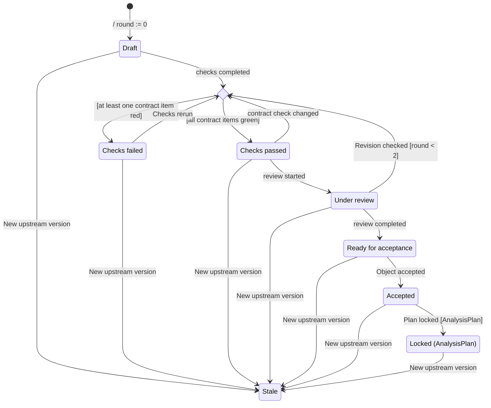
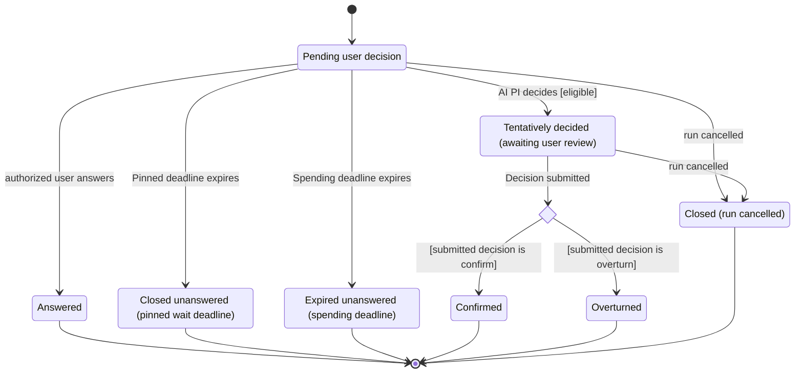
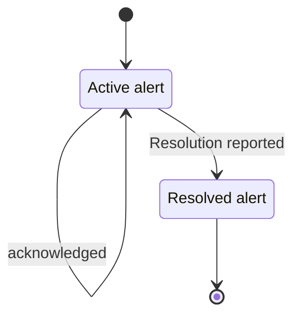

# State Machine Diagrams — Mermaid

Mỗi khối bên dưới là một state diagram độc lập, tương ứng một tab trong [file draw.io](State-Machine-Diagrams.drawio). Sao chép từng khối vào trình hỗ trợ Mermaid để vẽ. Mermaid tự sắp xếp nên vị trí đường nối có thể khác ảnh gốc.

Các nhãn được giữ ngắn như hình; nhánh choice ghi điều kiện đầy đủ. Chi tiết guard, effect, reason/result và giới hạn thiết kế xem [thuyết minh và bảng transition](State-Machine-Diagrams-design.md). Dataset available và notification unread/read là trạng thái khái niệm. Local Node và email retry là thiết kế dự kiến, không xác nhận runtime.

## 1. Authentication & Account

## 2. Project Workspace

## 3. Data Management

```mermaid
stateDiagram-v2
    state "Dataset available" as available
    [*] --> available : create first version with hash
    available --> available : new version; retain prior versions
    available --> [*] : authorized deletion confirmed
```

## 4. Research Run Orchestration

## 5. Research Engines

## 6. AI Principal Investigator

## 7. Notifications & Integrations

```mermaid
stateDiagram-v2
    state "Unread" as unread
    state "Read" as read
    [*] --> unread
    unread --> read : recipient marks as read; record read_at
```

## 8. Administration & Monitoring

